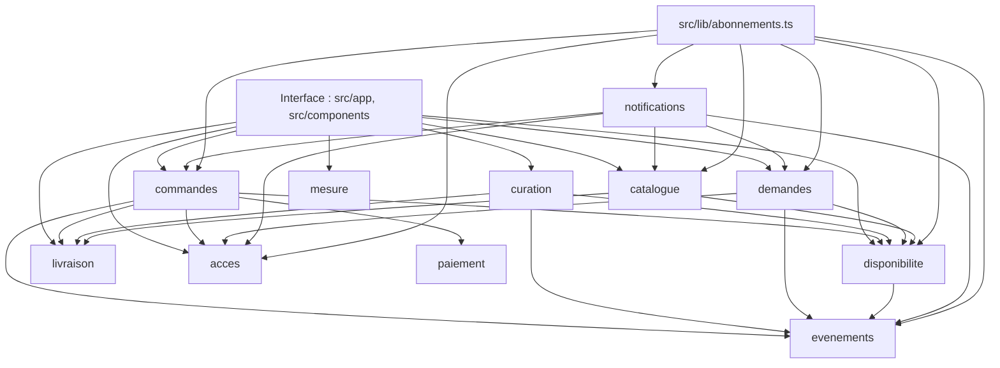
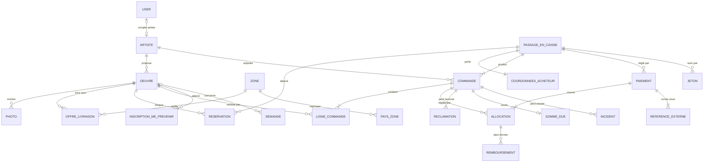
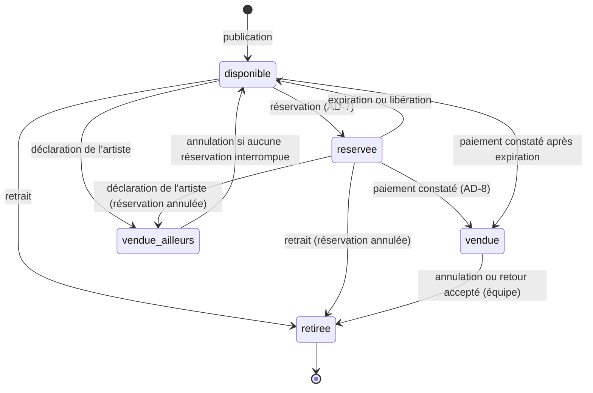
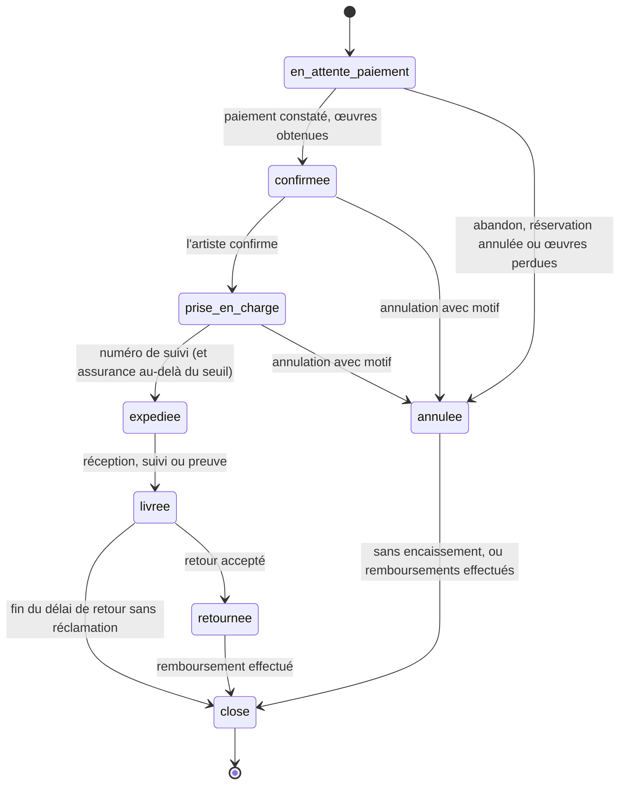
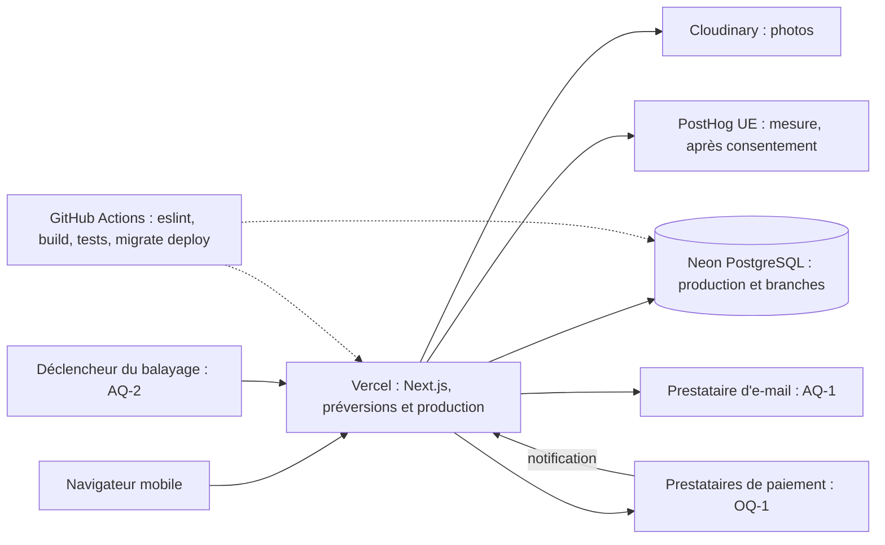

# Architecture Spine — Errancy

Ce document fixe les règles que tout epic, toute story et tout agent doivent respecter pour que des parties construites séparément restent compatibles. Les justifications sont dans `.memlog.md`, et les rapports de relecture dans `reviews/`. Le document **ne tranche pas** OQ-1 (montage de paiement) ni OQ-16 (un paiement par panier ou un par commande) : la frontière de paiement (AD-4) supporte les deux variantes.

## Design Paradigm

**Monolithe modulaire.** Un seul déploiement Next.js (App Router). La logique métier vit dans des modules côté serveur, `src/lib/<module>/`, qui exposent chacun une API publique dans leur `index.ts`. Pages, layouts, actions serveur et route handlers ne font que trois choses : valider l'entrée, construire l'acteur (AD-15) et appeler un module. Aux frontières externes (paiement, e-mail, mesure), le module définit une interface (port) et des adaptateurs interchangeables.

| Couche | Emplacement | Peut importer |
|---|---|---|
| Interface | `src/app/**`, `src/components/**` | API publique des modules (`@/lib/<module>`), `src/lib/types`, `src/lib/i18n` |
| Modules métier | `src/lib/<module>/` | Prisma (`@/lib/prisma`, `@/generated/prisma`), API publique des modules en aval (AD-3) |
| Adaptateurs | `src/lib/<module>/adaptateurs/<nom>/` | SDK du prestataire, types du port de leur module |
| Composition | `src/lib/abonnements.ts` | Gestionnaires d'événements des modules (AD-11) |

| Module | Rôle |
|---|---|
| `catalogue` | Lectures publiques (galerie, fiche, artistes, accueil) ; reprend `src/lib/db/` et `mappers.ts` |
| `curation` | Dépôt d'œuvre, photos, publication, pages artistes, validation par l'équipe |
| `disponibilite` | Disponibilité d'une œuvre, réservations, « vendue ailleurs » |
| `livraison` | Zones, offres de livraison par œuvre, prix total et délai total |
| `commandes` | Passage en caisse, commandes, états, prise en charge, expédition, livraison, clôture, réclamations, remboursements, sommes dues, incidents |
| `paiement` | Ports Encaissement, Remboursement, Reversement et leurs adaptateurs ; entité Paiement |
| `demandes` | Demandes de visite et de sélection (FR-8), « Me prévenir » (FR-9), contacts de maintenance (FR-35), rattachement des ventes assistées (FR-28) |
| `acces` | Acteur, rôles relus en base, jetons, invitations artiste |
| `evenements` | Catalogue des événements, journal (outbox), répartition, balayage |
| `notifications` | Port d'envoi d'e-mail, contenus des e-mails, alertes de l'équipe |
| `mesure` | Port Mesure (FR-27), consentement |
| `reglages` | Interrupteur du Lot 2, durées, seuils, taux et assiette |

## Invariants & Rules

Diagramme normatif des dépendances (AD-3). `reglages` et le type `Acteur` d'`acces` sont des feuilles importables par tous ; ils ne sont pas dessinés.



### AD-1 — Monolithe modulaire, Prisma confiné aux modules [ADOPTED]

- **Binds:** all
- **Prevents:** deux epics qui changent l'état d'une œuvre ou d'une commande chacun à sa façon, dans une route ou une page.
- **Rule:**
  - Seuls les fichiers de `src/lib/<module>/**`, et `src/auth.ts` pour l'adaptateur NextAuth, importent le client Prisma ou le code généré.
  - ESLint (`no-restricted-imports`) l'impose dès le premier epic, avec des motifs qui couvrent les chemins par alias et les chemins relatifs (`@/lib/prisma`, `@/generated/prisma*`, `**/lib/prisma`, `**/generated/prisma*`).
  - Les fichiers existants qui enfreignent la règle sont sur une liste d'exceptions. Un fichier n'en sort que lorsqu'un epic le reprend, et aucune entrée n'y est jamais ajoutée.
  - Hors d'un module, on n'importe que `@/lib/<module>`, c'est-à-dire son `index.ts`.
  - La CI lance `eslint .` explicitement (AD-23), car Next.js 16 ne lance plus le lint pendant le build.

### AD-2 — Un seul module propriétaire par donnée

- **Binds:** all
- **Prevents:** deux modules qui écrivent la même table ou le même champ avec des règles différentes.
- **Rule:** chaque donnée a un seul module qui l'écrit. Les autres la lisent par l'API publique de ce module, ou par `catalogue` pour les lectures publiques. Les coordonnées d'un acheteur ne sont stockées que dans `commandes` (passage en caisse) et dans `demandes` (demandes, inscriptions).

| Donnée | Module qui écrit |
|---|---|
| Artiste (page, accord signé), Œuvre (champs descriptifs, dimensions, photos, axe Publication) | `curation` |
| Œuvre (axe Disponibilité), Réservation | `disponibilite` |
| Zone, correspondance pays → zone, Offre de livraison | `livraison` (zones : équipe ; offres : artiste, via `curation` qui appelle `livraison`) |
| Passage en caisse, Coordonnées de l'acheteur, Commande, Ligne de commande, Réclamation, Remboursement, Somme due, Incident (SM-C1) | `commandes` |
| Paiement, Allocation paiement → commande, Référence externe | `paiement` (appelé par `commandes` dans sa transaction) |
| Demande, Inscription « Me prévenir », Contact de maintenance | `demandes` |
| User (rôle), Jeton, Invitation | `acces` |
| Événement (journal) et son traitement | `evenements` |
| Réglages | `reglages` |

### AD-3 — Sens des dépendances et réactions par événements

- **Binds:** all
- **Prevents:** les cycles entre modules, et les transactions ouvertes à deux endroits pour la même opération.
- **Rule:**
  - Un module n'appelle que les modules en aval dans le diagramme ci-dessus.
  - Quand un module en aval doit faire réagir un module en amont (par exemple `disponibilite` annule une réservation et `commandes` doit annuler la commande), il écrit un événement (AD-11), jamais un appel direct.
  - La transaction appartient au module qui orchestre l'opération. Les fonctions des modules en aval acceptent un client de transaction en paramètre facultatif, et n'ouvrent pas leur propre transaction quand on leur en fournit un.
  - Un gestionnaire d'événement ne fait rien si l'entité visée a déjà quitté l'état qu'il attendait.

### AD-4 — Frontière de paiement : un paiement couvre de 1 à N commandes

- **Binds:** FR-10, FR-13, FR-14, FR-31, FR-32, OQ-1, OQ-16
- **Prevents:** un modèle de commande taillé pour une seule variante d'OQ-1 ou d'OQ-16 ; une même notification traitée deux fois sous deux identifiants.
- **Rule:**
  - Un passage en caisse produit une commande par artiste. Un **Paiement** couvre une ou plusieurs commandes de ce passage, avec un montant alloué à chacune.
    - Paiement unique : 1 paiement pour N commandes.
    - Paiement par commande : N paiements d'une commande chacun.
    - Ce choix est un réglage du module `paiement`, pas une différence de modèle.
  - États d'un paiement : `ouvert` → `constate` ou `abandonne`. Un paiement ne passe à `constate` que par une mise à jour conditionnelle (`WHERE statut = 'ouvert'`) : c'est la clé d'idempotence.
  - Chaque identifiant externe d'un prestataire est rattaché à un seul Paiement, par une paire (source, référence externe) unique. Plusieurs identifiants pour le même paiement, comme les deux notifications du Stripe actuel, retombent sur le même Paiement.
  - Le module `paiement` expose trois ports distincts : **Encaissement** (ouvrir un paiement, interpréter une notification), **Remboursement** et **Reversement**.
    - L'adaptateur `constat-manuel` de l'Encaissement existe toujours : l'équipe y enregistre qui a constaté, quand, et avec quelle référence.
    - Remboursement et Reversement n'ont qu'un adaptateur manuel tant qu'OQ-1 est ouverte : l'équipe exécute l'opération, le système en trace l'état (`demandé`/`effectué` ; `à verser`/`versée`/`bloquée`).
  - Le webhook d'un adaptateur et le constat manuel appellent **le même point d'entrée synchrone**, `commandes.traiterPaiementConstate(fait)`. Ce point d'entrée vérifie le montant et la devise, puis confirme (AD-8) dans une seule transaction. Un écart de montant ou de devise ne confirme rien et crée un incident. L'événement `PaiementConstate` relate un fait accompli : il ne déclenche pas la confirmation.
  - Une contestation de paiement remontée par un adaptateur crée un incident. Son traitement suit OQ-1 et OQ-2.
  - Un nom de prestataire (Stripe ou autre) n'apparaît que dans `src/lib/paiement/adaptateurs/**`, dans les route handlers de notification et dans les variables d'environnement. Jamais dans un autre module, un écran ou un e-mail.
  - Le code Stripe actuel devient l'adaptateur `stripe-checkout`, sans que cela décide qu'il servira. Le chemin d'achat actuel (`POST /api/checkout`, bouton du panier, appel Stripe de `confirmation/page.tsx`) passe sous l'interrupteur du Lot 2 (AD-17) dès le premier epic. Le webhook actuel reste une exception à AD-1 jusqu'à sa réécriture en adaptateur.

### AD-5 — Formats de données communs

- **Binds:** all
- **Prevents:** des montants, pays, dimensions ou heures qui ne se comparent pas d'un module à l'autre.
- **Rule:**
  - **Montants** en centimes entiers (`Int`), accompagnés d'un code devise ISO 4217 (`EUR` tant qu'OQ-6 est ouverte). Aucun `Float` pour de l'argent.
  - **Pays** en ISO 3166-1 alpha-2.
  - **Dimensions** en millimètres entiers. Pouces, orientation et format (petit, moyen, grand) se calculent à l'affichage, avec des seuils de format qui sont des réglages (UXQ-7).
  - **Instants** stockés en UTC (`timestamptz`), affichés par la fonction de formatage commune (AD-18).

### AD-6 — Deux axes d'état pour une œuvre

- **Binds:** FR-6, FR-16, FR-20, FR-21, FR-25
- **Prevents:** un epic qui fusionne curation et disponibilité en un seul champ pendant qu'un autre les sépare.
- **Rule:**
  - **Publication** ∈ {`brouillon`, `en_curation`, `publiee`}, écrit par `curation`. La publication est refusée si l'artiste n'a pas d'accord signé enregistré (FR-16).
  - **Disponibilité** ∈ {`disponible`, `reservee`, `vendue`, `vendue_ailleurs`, `retiree`} (glossaire du PRD), écrit par `disponibilite` seulement.
  - Les sept états de l'écran artiste (EXPERIENCE.md) se calculent à partir des deux axes.
  - Une œuvre `retiree` n'est plus publique : son URL redirige en 301 vers la page de l'artiste (FR-6, NFR-2).
  - `Artwork.available` disparaît par migration (AD-20).

### AD-7 — Réservation sans double vente

- **Binds:** FR-9, FR-10, FR-12, FR-21, NFR-4, SM-C1
- **Prevents:** deux acheteurs qui réservent ou paient la même œuvre unique ; des écrans qui lisent la disponibilité de façons différentes.
- **Rule:**
  - **Disponibilité effective.** `disponibilite` exporte une seule définition de « disponible pour cet acheteur » : publiée, non retirée, sans réservation active d'un autre bénéficiaire, l'échéance comprise. Elle existe sous deux formes, un prédicat et un fragment de requête. Catalogue, réservation et confirmation l'utilisent tous, et la colonne brute n'est lue nulle part ailleurs.
  - **Réserver**, c'est passer chaque œuvre de disponible à `reservee` par une mise à jour conditionnelle construite sur ce fragment. La transaction couvre **toutes les œuvres du passage en caisse** : tout ou rien, quelles que soient les commandes et les artistes.
  - **La ligne Réservation.** Chaque réservation est une ligne `Reservation` qui porte :
    - l'œuvre ;
    - le passage en caisse (obligatoire) ;
    - l'origine : `paiement`, `vente_assistee` ou `priorite` ;
    - l'échéance ;
    - l'issue.

    Un **index unique partiel** « une seule réservation active par œuvre » garantit l'unicité en base. Il est déclaré dans le schéma par la préversion `partialIndexes` de Prisma (≥ 7.4), et un test de CI vérifie qu'il existe.
  - **Réservation déjà détenue.** Une réservation active du même passage en caisse ne bloque pas ce passage.
    - Une vente assistée crée un passage en caisse au nom de l'acheteur identifié. Le lien de commande envoyé par l'équipe porte un jeton `commande_assistee` qui rouvre ce passage (AD-14).
    - « Me prévenir » (FR-9) : à l'expiration, le gestionnaire pose une réservation d'origine `priorite` pour le premier inscrit, avec un délai réglable, puis pour le suivant.
  - **Expiration.** Une réservation échue est libérée dans la transaction même qui tente une nouvelle réservation. Le balayage (AD-11) ne sert qu'aux notifications et au nettoyage : la protection ne dépend jamais de son passage.
  - **Réglages.** Durées (environ 30 minutes au paiement, environ 48 h en vente assistée, délai de priorité) et plafond de réservations simultanées par e-mail et par appareil.
  - **Vendue ailleurs, retrait.** « Vendue ailleurs » et « retirer » passent par `disponibilite`. La réservation active est annulée et l'événement `ReservationAnnulee` est écrit. Le gestionnaire de `commandes` annule alors la commande en attente, prévient l'acheteur, alerte l'équipe et crée un incident. Le module retient aussi si la déclaration a interrompu une réservation.
  - **Annuler « vendue ailleurs ».** L'artiste peut revenir à `disponible` seulement si la déclaration n'a interrompu aucune réservation.
  - **Œuvre vendue.** Une œuvre `vendue` ne peut pas passer en « vendue ailleurs » : l'artiste passe par l'équipe, qui annule la commande et rembourse (AD-9).

### AD-8 — Confirmation conditionnelle et idempotente

- **Binds:** FR-13, FR-21, FR-31, NFR-4
- **Prevents:** une commande confirmée deux fois, une vente légitime remboursée à tort, une œuvre vendue à deux acheteurs quand des paiements arrivent en retard.
- **Rule:**
  - **Doublon.** Dans `traiterPaiementConstate`, si le Paiement n'est plus `ouvert`, rien ne se passe (AD-4).
  - **Pour chaque commande couverte.**
    - Ses œuvres passent en `vendue`, au profit de cette commande, par une seule mise à jour conditionnelle : l'œuvre est réservée pour ce passage en caisse, ou encore disponible au sens d'AD-7. Le nombre de lignes modifiées doit égaler le nombre d'œuvres : tout ou rien par commande.
    - En cas de succès, la commande passe de `en_attente_paiement` à `confirmee`.
    - Sinon, la commande n'est pas honorable : elle passe en `annulee`, un remboursement égal à son allocation est créé à l'état `demandé`, et un incident SM-C1 est enregistré. Les autres commandes du même paiement restent confirmées.
  - **Deux échéances distinctes.** L'expiration d'une réservation n'annule pas la commande. Une commande en attente porte sa propre **échéance d'abandon**, réglable et plus longue que la réservation. Un paiement constaté avant cette échéance confirme si les œuvres sont encore disponibles.
  - **Paiement après abandon.** Un paiement constaté sur une commande déjà `annulee` ne la confirme jamais : il crée un remboursement et un incident.

### AD-9 — États de commande gouvernés par une seule table de transitions

- **Binds:** FR-13, FR-15, FR-22, FR-26, FR-29, FR-30, FR-31, FR-33
- **Prevents:** des écrans artiste, équipe et acheteur qui font avancer une commande par des chemins différents ou vers des états hors glossaire.
- **Rule:**
  - Les états sont ceux du glossaire : `en_attente_paiement`, `confirmee`, `prise_en_charge`, `expediee`, `livree`, `close`, `annulee`, `retournee`.
  - Ils ne changent que par les fonctions de `commandes`. Chaque fonction vérifie que la transition est autorisée (diagramme du Structural Seed), vérifie l'acteur (AD-15), puis écrit l'événement correspondant (AD-11). Chaque transition horodate son passage et retient qui l'a faite.
  - Au-delà d'un seuil de prix figé (réglage, OQ-5), `expediee` exige un numéro de suivi avec assurance, et `livree` exige une preuve de livraison (FR-29).
  - Une commande `annulee` sans encaissement passe aussitôt en `close`. Avec encaissement, elle passe en `close` quand ses remboursements sont `effectué`.
  - Après une annulation ou un retour accepté, l'équipe fait passer l'œuvre `vendue` à `retiree` par `disponibilite`. L'artiste peut ensuite la remettre en vente, ce qui la renvoie en curation.

### AD-10 — Échéances stockées, états temporels calculés à la lecture

- **Binds:** FR-12, FR-15, FR-22, FR-26, FR-33
- **Prevents:** des écrans faux, ou différents d'un écran à l'autre, quand une tâche planifiée n'est pas passée.
- **Rule:**
  - Une échéance est stockée sur la ligne qu'elle concerne : fin de réservation, abandon de commande, prise en charge attendue, expédition attendue, fin du délai de retour, fin de validité d'un jeton.
  - « En retard », « expirée » et « lien inactif » se calculent à la lecture, par une fonction du module propriétaire. « Lien de suivi inactif » est calculé par `commandes`, à partir de l'état des commandes du passage.
  - Seules les transitions finales à date (clôture, FR-33) sont posées par le balayage, et de façon idempotente.

### AD-11 — Effets de bord par journal d'événements (outbox)

- **Binds:** FR-8, FR-9, FR-13, FR-15, FR-21, FR-22, FR-25, FR-26, FR-31, FR-34, FR-35
- **Prevents:** des e-mails perdus sans trace ou envoyés en double, des noms ou charges utiles d'événements qui divergent, des réactions entre modules qui se court-circuitent.
- **Rule:**
  - **Catalogue des événements.** Tous les événements sont déclarés dans un catalogue typé unique, `src/lib/evenements/catalogue.ts`, avec leur nom et leur charge utile. Un événement absent du catalogue ne peut pas être écrit.
  - **Écriture.** Un changement d'état qui doit produire un effet (e-mail, alerte, réaction d'un autre module, invalidation du cache) écrit l'événement dans la même transaction.
  - **Répartition.** Une seule fonction de `evenements` répartit les événements après la réponse : `waitUntil` (`@vercel/functions`) sous Next.js 14, `after()` sous Next.js 16.
  - **Balayage.** Il rejoue les échecs, pose les transitions à date et envoie les notifications liées au temps (FR-9, alertes à 48 h et d'expédition).
  - **Idempotence.** Avant d'agir, chaque gestionnaire réclame de façon atomique la paire (événement, gestionnaire), si bien que la répartition immédiate et le balayage ne traitent jamais deux fois le même événement.
  - **Abonnements** déclarés dans `src/lib/abonnements.ts`. Aucun e-mail n'est envoyé directement depuis une route ou une action.

### AD-12 — Prix total, zones, pays choisi et commande figée

- **Binds:** FR-3, FR-4, FR-10, FR-11, FR-17, FR-20, FR-24, OQ-5, OQ-13
- **Prevents:** un prix affiché sur la fiche différent du prix filtré, du prix du panier ou du montant encaissé.
- **Rule:**
  - **Calcul.** Une seule fonction de `livraison` calcule, pour une œuvre et un pays, le prix total et le délai total, ou indique « pas de livraison vers ce pays ». Fiche, galerie (dans sa version requête, pour le filtre de prix), panier et encaissement l'utilisent tous.
  - **Pays choisi.** Le pays de livraison choisi est un code ISO conservé dans un cookie `pays`. Le serveur le lit et le passe explicitement aux fonctions de prix ; aucun composant ne calcule de prix. Sa valeur par défaut suit OQ-13 ; en attendant, c'est la France, modifiable.
  - **Zones.** Les zones et la correspondance pays → zone sont des données modifiables par l'équipe, pas du code (OQ-5).
  - **Offres.** Une offre de livraison existe par œuvre et par zone acceptée : frais, délai de préparation, délai de transport minimal et maximal. Le dépôt propose de reprendre les zones de la dernière œuvre de l'artiste.
  - **Prix figés.** Les montants sont figés à la création du passage en caisse, c'est-à-dire au début de la réservation. Par ligne, la commande garde l'id de l'œuvre, un instantané du slug et du titre, le prix de l'œuvre, les frais, la devise, la zone et le délai. Un changement ultérieur de tarif ou de slug ne la modifie jamais. Les montants viennent toujours de la base, jamais du navigateur.

### AD-13 — Acheteur sans compte, panier côté navigateur

- **Binds:** FR-10, FR-11, FR-15
- **Prevents:** un tunnel qui réintroduit l'obligation de compte, ou un montant repris du navigateur.
- **Rule:**
  - `/panier` et le tunnel de commande sont publics : `/panier` sort des routes protégées.
  - Le panier du navigateur (Zustand persistant) ne garde que des slugs, plus d'éventuelles données d'affichage que le serveur ne relit jamais.
  - Le passage en caisse est créé en base au début de la réservation. C'est lui qui porte les coordonnées de l'acheteur (e-mail, nom, adresse, téléphone), sans `User`.
  - Un compte pourra y être rattaché plus tard (UXQ-9) sans modifier les commandes.

### AD-14 — Jetons

- **Binds:** FR-9, FR-15, FR-34, NFR-6
- **Prevents:** des liens devinables, des jetons lisibles en base ou divulgués par une URL, et un mécanisme différent pour chaque lien.
- **Rule:**
  - **Création et vérification.** `acces` est le seul module à créer et vérifier les jetons. Un jeton est aléatoire, d'au moins 256 bits.
  - **Stockage.** Seule son empreinte SHA-256 est stockée, avec :
    - son usage : `suivi`, `invitation`, `desinscription` ou `commande_assistee` ;
    - sa cible ;
    - son échéance.
  - **Émission à l'envoi.** Un jeton est émis au moment de l'envoi de l'e-mail qui le porte, par le gestionnaire de `notifications` qui appelle `acces`. La valeur en clair n'existe que dans l'e-mail.
  - **Jetons de suivi.** Ils visent le passage en caisse et montrent toutes ses commandes. Chaque e-mail de commande en porte un nouveau, ancré sur la commande. Tous expirent à la clôture de la dernière commande du passage : à ce moment, un gestionnaire d'événement les révoque.
  - **Ouverture d'un lien.** `/suivi/[jeton]` (et de même `/auth/invitation/[jeton]`) échange le jeton contre un cookie `httpOnly`, puis redirige vers une URL sans jeton. Ces pages sont servies avec `Referrer-Policy: no-referrer` et exclues de la mesure.

### AD-15 — Autorisation dans les modules, rôle relu en base

- **Binds:** FR-22, FR-25, FR-26, FR-34, NFR-5
- **Prevents:** un contrôle d'accès oublié dans une nouvelle route, et un rôle périmé dans le JWT.
- **Rule:**
  - **Acteur.** Toute fonction de module qui lit des données privées ou modifie quelque chose reçoit un **acteur** et vérifie elle-même ses droits. Les acteurs possibles :
    - `visiteur` ;
    - `acheteur`, porteur d'un jeton ;
    - `artist`, rattaché à son artiste : il n'agit que sur ses œuvres et ses commandes ;
    - `admin` ;
    - `systeme`, pour les gestionnaires et le balayage, qui précise le destinataire de l'effet.
  - **Rôle relu en base.** L'acteur est construit par `acces`, qui relit le rôle en base à chaque action protégée et à chaque rendu d'un espace protégé.
  - **Middleware.** Il ne vérifie plus que la présence d'une session sur `/dashboard/**`. Les redirections par rôle se font dans les layouts, à partir du rôle relu. C'est ce qui satisfait FR-34 sans reconnexion, et cela remplace le contrôle de rôle actuel de `src/middleware.ts`.
  - Rôles : `user` | `artist` | `admin` [ADOPTED].

### AD-16 — Données de l'acheteur filtrées à la source, par destinataire

- **Binds:** FR-8, FR-22, NFR-5, NFR-6
- **Prevents:** un écran ou un e-mail qui expose l'adresse ou les coordonnées par simple oubli d'une condition.
- **Rule:**
  - Pour un destinataire `artist`, que ce soit à l'écran ou dans un e-mail, `commandes` ne renvoie l'adresse et le téléphone de l'acheteur que pour une commande `prise_en_charge` ou `expediee`. Avant et après, seuls le prénom et le pays sortent du module.
  - Les coordonnées de l'artiste ne sortent jamais vers un visiteur ni vers un acheteur.
  - Les journaux et les charges utiles d'événements ne contiennent que des ids.

### AD-17 — Interrupteur du Lot 2 côté serveur

- **Binds:** FR-6, FR-10, FR-11, FR-12, FR-13, FR-14, FR-15, Lots 1 et 2
- **Prevents:** un bouton « Acheter » masqué à l'écran alors que le serveur accepte une commande, ou l'inverse.
- **Rule:**
  - Une variable d'environnement Vercel, lue par une seule fonction de `reglages`, dit si le Lot 2 est ouvert.
  - L'interface et les fonctions de `commandes` qui ouvrent un passage en caisse public la consultent. Tant que le Lot 2 est fermé, le serveur refuse ce passage, y compris par le chemin d'achat existant (AD-4).
  - Les ventes assistées par l'équipe (réservation, lien `commande_assistee`, constat manuel) n'en dépendent pas : OQ-12 reste possible sans être tranchée.
  - Pas de *feature flag* PostHog pour cette règle. L'ouverture est un geste du porteur, comme `MAINTENANCE_MODE`.

### AD-18 — Textes et formats prêts pour l'international (OQ-6)

- **Binds:** NFR-8, FR-1, FR-3, FR-17, OQ-6, OQ-13
- **Prevents:** des chaînes en dur dans les composants et des formats faits à la main, qu'il faudrait reprendre un par un le jour où une langue ou une devise s'ajoute.
- **Rule:**
  - Les textes d'interface et d'e-mail vivent dans un dictionnaire français typé (`src/lib/i18n/`). Aucun composant n'écrit de chaîne visible en dur.
  - Dates, heures (« 15 h 42 »), montants et dimensions passent par les fonctions de formatage de `src/lib/i18n/`, en locale `fr`.
  - Les URL restent en français, sans préfixe de langue.
  - Aucune bibliothèque d'internationalisation tant qu'OQ-6 est ouverte.

### AD-19 — Mesure par une seule interface, avec consentement

- **Binds:** FR-27, FR-28, SM-2, SM-3, NFR-6, OQ-9
- **Prevents:** des appels directs à l'outil de mesure dispersés dans les composants, et des événements envoyés sans consentement.
- **Rule:**
  - Les événements de FR-27 forment une liste typée unique dans `mesure` : nom, slug de l'œuvre, source d'arrivée.
  - Ils ne partent que par le port Mesure, qui vérifie le consentement et compte le taux de consentement (SM-2).
  - Adaptateur de production : **PostHog, hébergement UE** (OQ-9, tranchée par le porteur).
  - Aucun composant n'importe le SDK PostHog, et aucune URL portant un jeton n'est mesurée.

### AD-20 — Migrations de données en quatre temps

- **Binds:** NFR-7, NFR-2
- **Prevents:** une bascule en une fois sans retour arrière, des lectures cassées pendant une migration, et une base qui ne correspond plus à l'historique des migrations.
- **Rule:**
  - **Ligne de base, avant toute autre migration.** Une migration de ligne de base aligne l'historique Prisma sur la base réelle. Aujourd'hui, `Order` et `Artist.userId` existent dans le schéma sans migration : on génère le diff, puis on le marque comme appliqué en production.
  - **Point d'application unique.** `prisma migrate deploy` ne s'exécute qu'à un seul endroit, une étape explicite de CI ou du porteur. Jamais dans le build Vercel, jamais par `db push` sur une base partagée.
  - **Quatre déploiements, chacun réversible.** Tout changement de forme d'une donnée existante suit quatre déploiements séparés :
    1. ajouter (nouvelles colonnes ou tables) ;
    2. recopier (script idempotent, correspondance vérifiée) ;
    3. basculer les lectures ;
    4. supprimer l'ancien, après une période de vérification.
  - Répétition sur une branche Neon ; sauvegarde par restauration à un instant donné (fenêtre : AQ-4).
  - **Données concernées d'abord** :
    - `Artwork.available`, `price` (`Float`) et `dimensions` (texte) ;
    - `Order.artworkIds` (CSV), `amount` (`Float`), `currency`, `status`, `stripeSessionId`, `stripePaymentIntentId` et `userId`, qui se répartissent vers le passage en caisse, la commande, la ligne de commande et le paiement (AD-4).
  - Tout changement d'URL publique a sa redirection 301.

### AD-21 — Fraîcheur et cache des pages publiques

- **Binds:** FR-3, FR-6, FR-21, NFR-1, NFR-2
- **Prevents:** une œuvre vendue ailleurs encore achetable à l'écran pendant des minutes, un prix mis en cache pour le mauvais pays, ou des pages lentes sur mobile.
- **Rule:**
  - Le cache porte sur les **données** du catalogue (requêtes étiquetées par œuvre et par artiste, revalidation d'au plus 60 secondes), pas sur les pages entières. Les pages qui affichent un prix se rendent par requête, avec le pays du cookie (AD-12).
  - Tout changement de disponibilité ou de publication invalide les étiquettes de l'œuvre et de son artiste. Cette invalidation passe par un gestionnaire d'événement (AD-11), donc après validation de la transaction.
  - La disponibilité affichée est indicative : seule la réservation (AD-7) fait foi.
  - Les photos passent par Cloudinary et `next/image`, au format et à la taille de l'écran (NFR-1).

### AD-22 — Environnements et adaptateurs hors production

- **Binds:** NFR-5, NFR-6, NFR-7
- **Prevents:** un vrai débit, un vrai e-mail à un acheteur ou une œuvre réelle bloquée depuis une préversion.
- **Rule:**
  - Trois environnements : local, préversion Vercel, production.
  - Hors production, les adaptateurs de paiement, d'e-mail et de mesure tournent en mode test ou en mode journal.
  - Une préversion n'écrit jamais dans la base de production (AQ-3).
  - Les fonctions Vercel tournent dans la région de la base Neon.
  - La maintenance et `robots.txt` restent pilotés par le porteur (`MAINTENANCE_MODE`) [ADOPTED].

### AD-23 — Tests et intégration continue

- **Binds:** NFR-4, NFR-5, all
- **Prevents:** un agent qui pousse du code qui casse le lint, le build ou la protection contre la double vente.
- **Rule:**
  - Outil : Vitest. Les tests des modules tournent sur un vrai PostgreSQL jetable, jamais avec des bouchons pour la concurrence.
  - GitHub Actions lance `eslint .`, `npm run build` et les tests à chaque PR.
  - Premiers tests :
    - les trois cas de NFR-4 : achat simultané, paiement après expiration de la réservation, vente ailleurs pendant une réservation ;
    - le doublon de notification d'AD-4 ;
    - la présence de l'index partiel d'AD-7.

    Ils doivent passer avant l'ouverture du Lot 2.
  - AGENTS.md est mis à jour dans l'epic qui installe la CI.

### AD-24 — Somme due à l'artiste calculée en un seul endroit

- **Binds:** FR-31, FR-32, FR-33, SM-6, OQ-3
- **Prevents:** une commission calculée différemment dans l'espace artiste, l'administration et les reversements, ou des remboursements qui dépassent ce qui a été payé.
- **Rule:**
  - Une seule fonction de `commandes` calcule commission et somme due pour une commande.
  - Le taux (30 %, décision du porteur) et l'**assiette** (œuvre seule ou livraison comprise, OQ-3) sont des réglages, figés sur la commande à sa confirmation.
  - Le montant dû est recalculé à la clôture, déduction faite des remboursements. Il passe alors `à verser` (FR-33), puis il est versé par le port Reversement (AD-4).
  - Un remboursement vise une paire (paiement, commande). La somme des remboursements ne dépasse jamais le montant alloué à cette commande.

## Consistency Conventions

| Concern | Convention |
|---|---|
| Noms de code | Modules, fichiers et fonctions métier en français sans accent (`disponibilite`, `reserverOeuvres`, `passageEnCaisse`). Énumérations en `snake_case` français (`vendue_ailleurs`). Les modèles Prisma existants gardent leur nom jusqu'à leur migration. |
| Noms d'événements | `NomAuPasseCompose` en français (`ReservationAnnulee`, `CommandeConfirmee`, `PaiementConstate`), déclarés dans le catalogue d'AD-11. Charge utile minimale : des ids, jamais de donnée personnelle. |
| Identifiants | `cuid` pour les ids internes. L'œuvre est désignée par son **slug** dans les URL et le panier, et par son **id** dans les commandes, avec un instantané du slug (AD-12) (amende la convention d'AGENTS.md sur `Order.artworkIds`, validé par le porteur). Le numéro de commande lisible est distinct de l'id, et un seul générateur le produit, dans `commandes`. |
| URL et textes | URL et textes en français (`/galerie`, `/panier`, `/suivi/[jeton]`) [ADOPTED]. Apostrophes JSX en `&apos;` [ADOPTED]. |
| Mutations | Les mutations déclenchées par l'interface passent par des actions serveur. Les route handlers sont réservés aux appelants externes (notifications de paiement, balayage, upload). Les routes API existantes du tableau de bord migrent au fil des epics. |
| Résultats et erreurs | Les fonctions de module renvoient `{ ok: true, … }` ou `{ ok: false, code }` pour les refus attendus (`oeuvre_indisponible`, `transition_interdite`, `acces_refuse`), et ne lèvent une exception que pour l'imprévu. Le texte affiché vient du dictionnaire, à partir du `code`. |
| Validation | Toute entrée externe (formulaire, notification, paramètre d'URL) est validée à la frontière, avant l'appel au module. |
| Abus | Plafonds de réservations (AD-7) et limitation du nombre d'envois de formulaires publics par adresse IP et par e-mail. |
| Journalisation | Aucune donnée personnelle (adresse, téléphone, e-mail complet) ni aucun jeton dans les journaux : on journalise des ids. |
| Configuration et secrets | Secrets dans `.env.local` et dans les variables Vercel, jamais dans le dépôt [ADOPTED]. Les réglages métier (durées, seuils, taux, assiette) sont lus par `reglages`. |
| Dépendances | Versions épinglées : jamais `@latest` (celle de Prisma pointe sur une version candidate). `engines.node` déclaré dans `package.json`. |
| Code généré et démonstration | Ne jamais modifier `src/generated/prisma/` [ADOPTED]. Aucun nouvel usage de `src/data/*` [ADOPTED]. |

## Stack

| Name | Version |
|---|---|
| Node.js | **24 LTS** : `engines.node` `24.x` (plage bornée, car Vercel applique `engines` en priorité sur le réglage du projet) et réglage Node du projet Vercel en 24.x |
| Next.js (App Router) | 14.2.5 → **14.2.35** tout de suite, puis **16.x** (16.4.3 au 2026-10-27) dans un epic dédié |
| React | 18.3, puis 19 avec Next.js 16 |
| TypeScript, `@types/node` | 5.x (strict), `@types/node` 24 |
| ESLint | 8 (`next lint`), puis 9 en configuration plate avec Next.js 16 |
| Prisma ORM + `@prisma/adapter-pg` | `~7.10` (7.10.1) ; préversion `partialIndexes` |
| PostgreSQL | Neon |
| NextAuth (Auth.js) | 5.0.0-beta.32 |
| Stripe SDK (adaptateur `stripe-checkout` seulement) | 22.x (installé) |
| Cloudinary SDK | 2.x |
| Zustand | 5.x |
| Tailwind CSS + framer-motion | 3.4 + 11.18 |
| `@vercel/functions` (`waitUntil`, sous Next.js 14) | version courante à épingler dans l'epic événements |
| PostHog (hébergement UE) | SDK courant à épingler dans l'epic mesure |
| Vitest | 5.0.5 |
| Hébergement, CI | Vercel ; GitHub Actions |

## Structural Seed

### Arborescence

```text
src/
  app/                      # pages, layouts, actions serveur, route handlers (minces)
    api/webhooks/stripe/    # notification de l'adaptateur stripe-checkout (reste idempotent)
    api/balayage/           # déclencheur protégé du balayage (AD-11)
  components/               # composants d'interface, sans accès aux données
  lib/
    prisma.ts               # client Prisma (importable par les modules seulement)
    abonnements.ts          # abonnements aux événements (racine de composition)
    i18n/                   # dictionnaire fr typé + formatage (AD-18)
    types/                  # types d'affichage partagés
    catalogue/              # reprend lib/db/ + mappers.ts quand un epic les touche
    curation/  disponibilite/  livraison/  commandes/  demandes/
    paiement/
      ports.ts              # Encaissement, Remboursement, Reversement
      adaptateurs/          # constat-manuel/, stripe-checkout/, …
    acces/  evenements/  notifications/  mesure/  reglages/
    store/cart.ts           # panier du navigateur : slugs seulement (AD-13)
  middleware.ts             # devient src/proxy.ts avec Next.js 16 (jamais à la racine)
prisma/schema.prisma        # ligne de base, puis migrations en quatre temps (AD-20)
```

### Entités principales



### Disponibilité d'une œuvre



### États d'une commande



### Déploiement et prestataires



## Capability → Architecture Map

| Capability / Area | Lives in | Governed by |
|---|---|---|
| FR-1, FR-2, FR-5, FR-18, FR-19 : fiche, accueil, artistes | `catalogue`, `curation` | AD-1, AD-5, AD-6, AD-18, AD-21 |
| FR-16 : catalogue réel, accord signé | `curation` | AD-6 |
| FR-3, FR-4, FR-17 : prix et délai total, filtres | `livraison`, `catalogue` | AD-12, AD-5, AD-21 |
| FR-6 : actions selon la disponibilité | interface + `disponibilite`, `reglages` | AD-6, AD-7, AD-17, AD-21 |
| FR-7 : Conseil WhatsApp | interface + `mesure` | AD-18, AD-19 |
| FR-8, FR-28, FR-35 : demandes, ventes assistées, maintenance | `demandes` | AD-11, AD-14, AD-16 |
| FR-9 : Me prévenir | `demandes`, `disponibilite` | AD-7 (origine `priorite`), AD-11 |
| FR-10, FR-11 : panier et récapitulatif | `commandes`, `livraison` | AD-13, AD-12, AD-4 |
| FR-12 : réservation | `disponibilite` | AD-7, AD-10 |
| FR-13 : confirmation | `commandes`, `paiement` | AD-8, AD-4 |
| FR-14 : encaissement | `paiement` (adaptateurs) | AD-4 — **bloqué par OQ-1** |
| FR-15 : suivi par lien | `commandes`, `acces` | AD-14, AD-16, AD-10 |
| FR-20, FR-21, FR-25 : dépôt, disponibilité, curation | `curation`, `disponibilite`, `livraison` | AD-6, AD-7, AD-12, AD-15 |
| FR-22, FR-26, FR-29, FR-30, FR-33 : après-vente | `commandes` | AD-9, AD-10, AD-11, AD-16 |
| FR-23, FR-24 : pages légales et de confiance | interface (contenu) | AD-18 ; contenu selon OQ-1, OQ-2, OQ-4, OQ-5 |
| FR-27 : mesure | `mesure` | AD-19 |
| FR-31 : remboursement | `commandes`, `paiement` | AD-4, AD-8, AD-24 — moyen **bloqué par OQ-1** |
| FR-32 : somme due | `commandes`, `paiement` | AD-24, AD-4 — calcul selon OQ-3, versement selon OQ-1 |
| FR-34 : invitation artiste, rôle | `acces` | AD-14, AD-15 |
| NFR-1 : performance mobile | interface, Cloudinary | AD-21 ; seuil LCP à confirmer |
| NFR-2 : référencement | interface | AD-6, AD-20, AD-21 |
| NFR-3 : accessibilité | interface | DESIGN.md, EXPERIENCE.md |
| NFR-4 : fiabilité de la vente | `disponibilite`, `commandes`, `paiement` | AD-4, AD-7, AD-8, AD-23 |
| NFR-5 : sécurité | `acces`, tous | AD-1, AD-14, AD-15, AD-16, AD-23 ; Next.js 14.2.35 puis 16.x ; Node 24 |
| NFR-6 : données personnelles | `commandes`, `demandes`, `mesure` | AD-14, AD-16, AD-19 ; durée de conservation : AQ-6 |
| NFR-7 : migration progressive | `prisma/` | AD-20, AD-22 |
| NFR-8 : langue et devise | `src/lib/i18n` | AD-18, AD-5 |

## Questions ouvertes

| Id | Question | Effet sur l'architecture | À trancher |
|---|---|---|---|
| OQ-1 | Montage de paiement : entité qui encaisse, prestataires, devise d'encaissement, contestations, rail de reversement par pays, vérification d'identité (KYC) | Quels adaptateurs Encaissement, Remboursement et Reversement s'ajoutent à `constat-manuel` ; identité de l'exploitant (FR-23) | Le porteur, après l'avis juridique marocain |
| OQ-16 | Un paiement pour tout le panier, ou un par commande | Réglage du module `paiement`, sans changement de modèle (AD-4) | Avec OQ-1 |
| OQ-2, OQ-4 | Garanties ; politique de retour (durée, frais, avoir) | Contenu de FR-24 ; durée du délai de retour, qui est un réglage (AD-10) | Le porteur, avec OQ-1 |
| OQ-3 | Assiette de la commission ; qui paie les frais de paiement | Réglage d'AD-24 | Avant l'epic du Lot 2 |
| OQ-5 | Zones de livraison, qui paie la livraison, douane, seuil d'assurance | Composition des zones : **avant l'ouverture du Lot 1** (FR-3, FR-4, FR-20, SM-4) ; seuil de FR-29 et contenu de FR-24 : avant le Lot 2 | Le porteur |
| OQ-6 | Langues et devises supplémentaires | Bibliothèque d'internationalisation et préfixes d'URL ; devises d'affichage ou d'encaissement (AD-5, AD-18) | Le porteur |
| OQ-7 | Numéro, horaires et délai WhatsApp | Réglages ; repli FR-8 d'ici là | Avant l'ouverture au public |
| OQ-8 | Qui mène la visite, délai de confirmation | Contenu et réglages de `demandes` | Le porteur |
| OQ-9 | Outil de mesure | **Tranchée** : PostHog, hébergement UE (AD-19) | — |
| OQ-10, OQ-11 | Catalogue de lancement ; date, budget, ressources | Plans Vercel et Neon (AQ-2, AQ-4) | Le porteur |
| OQ-12 | Ouvrir avec des ventes assistées avant le Lot 2 | Possible sans changement (AD-17 + `constat-manuel`) ; FR-12, FR-13 et FR-26 avancent alors avec le Lot 1 | Le porteur, avec OQ-1 |
| OQ-13 | Pays du visiteur déduit ou choisi | Valeur par défaut du cookie `pays` (AD-12) | UX ou porteur |
| OQ-14 | Part rédigée par l'artiste sur sa page | Droits d'écriture dans `curation` | Le porteur |
| OQ-15 | Critères de sortie de maintenance | Aucun code (AD-22) | Le porteur |
| AQ-1 | Prestataire d'e-mails transactionnels (la stratégie cite Resend) ; critère : hébergement ou garanties de transfert UE (RGPD) | Adaptateur du port d'envoi d'e-mail | Avant le premier epic qui envoie un e-mail |
| AQ-2 | Plan Vercel. Hobby limite les tâches planifiées à une par jour et exclut, d'après les conditions de Vercel, l'usage commercial : Pro sera probablement nécessaire | Déclencheur du balayage : Vercel Cron (Pro) ou déclencheur externe planifié vers `api/balayage` | Le porteur, avec OQ-11, avant l'epic qui livre FR-9 |
| AQ-3 | Base utilisée aujourd'hui par les préversions Vercel | Si c'est la base de production : passer les préversions sur une branche Neon (AD-22) | Premier epic qui écrit en base |
| AQ-4 | Plan Neon et fenêtre de restauration à un instant donné (courte sur le plan gratuit) | Faisabilité du retour arrière d'AD-20 | Avant la première migration de données |
| AQ-5 | Obligations des places de marché : traçabilité des vendeurs (DSA), déclaration fiscale des revenus des vendeurs (DAC7), export des biens culturels | Données à recueillir sur l'artiste dans `curation` ; exports pour l'équipe | Avis juridique, avec OQ-1 |
| AQ-6 | Durée de conservation des données personnelles et purge (NFR-6) | Purge par le balayage (AD-11) | Le porteur, avant l'ouverture du Lot 2 |

## Deferred

| Point | Pourquoi il peut attendre |
|---|---|
| Montée vers Next.js 16.x : React 19, `src/proxy.ts` avec export par défaut (à confirmer sur la documentation d'Auth.js), nouvelle signature de `revalidateTag`, ESLint 9 en configuration plate, `after()` à la place de `waitUntil` | Epic dédié après le passage à 14.2.35 ; les modules ne dépendent pas de la version. AGENTS.md est mis à jour dans cet epic. |
| Schéma Prisma détaillé (colonnes, index autres que celui d'AD-7) | Le code le possède ; les AD fixent les propriétaires, les formats et les états. |
| Format du numéro de commande lisible | Un seul générateur dans `commandes` ; aucun autre module ne l'interprète. |
| Moment exact où démarrent les 30 minutes (affichage du panier ou passage au paiement, UXQ-2) ; fuseau des heures affichées (UXQ-10) | L'architecture supporte les deux ; c'est une décision UX. |
| Gabarits visuels des e-mails | EXPERIENCE.md fixe contenu et déclencheurs ; le gabarit vient avec l'epic notifications. |
| Tarifs de livraison par défaut au niveau de l'artiste | Option C retenue : par œuvre au MVP, ajout ultérieur sans changement de modèle. |
| Rail de reversement par pays, KYC, coordonnées de versement | Dépendent d'OQ-1 ; le port Reversement est déjà en place. |
| Rattachement d'un compte acheteur après coup (UXQ-9) | AD-13 le permet sans migration. |
| Seuil LCP de NFR-1 (2,5 s supposé par le PRD) | Valeur à confirmer à la baseline ; AD-21 fixe le mécanisme. |
| Observabilité au-delà des journaux Vercel (alertes d'erreur) | Aucune exigence chiffrée au MVP ; à revoir avant l'ouverture du Lot 2. |
| `/expositions`, `/wishlist`, `/dashboard` générique | Hors spec UX ; laissés en l'état. |
